# Calculadora Java

Projeto acadêmico de qualidade de software, desenvolvido para simular um módulo de cálculos básicos da startup fictícia FinançApp.

**Projeto:** `projeto_calculadora`  
**Pacote:** `calculadora`
**Autor:** 'Lucas Torres Fernandes'
**RA:** '251217'

## Objetivo

Implementar uma calculadora funcional em Java e aplicar testes funcionais, testes unitários, tratamento de erros, refatoração, documentação técnica e versionamento com Git.

## Tecnologias utilizadas

- Java 21 (projeto configurado para Java 17 ou superior).
- Visual Studio Code e PowerShell.
- JavaDoc para documentação HTML.
- Git e GitHub para versionamento.
- Maven e JUnit 5: integração disponível, ainda não executada no ambiente local.

## Operações e tratamento de erros

O método `calc(int a, int b, String op)` recebe dois inteiros e um operador, retornando um `double`.

| Operador | Operação | Exemplo | Resultado |
|---|---|---|---|
| `+` | Soma | 10 + 5 | 15.0 |
| `-` | Subtração | 10 - 5 | 5.0 |
| `*` | Multiplicação | 10 * 5 | 50.0 |
| `/` | Divisão | 10 / 4 | 2.5 |

A divisão por zero gera `ArithmeticException`; operadores inválidos ou nulos geram `IllegalArgumentException`. A interface de terminal trata os erros e permite continuar realizando operações. Entradas não inteiras também são tratadas. Digite `sair` quando solicitado o primeiro número para encerrar.

O uso de `double` é didático; aplicações financeiras reais que exigem precisão decimal devem considerar `BigDecimal`.

## Estrutura do projeto

```text
projeto_calculadora/
├── src/
│   ├── main/java/calculadora/
│   │   ├── Calculadora.java
│   │   └── Main.java
│   └── test/java/calculadora/
│       ├── TesteCalculadora.java
│       └── CalculadoraJUnitTest.java
├── docs/
│   └── index.html
├── evidencias/
│   ├── antes_refatoracao/
│   ├── depois_refatoracao/
│   ├── documentacao/
│   ├── antes.txt
│   └── depois.txt
├── pom.xml
├── .gitignore
└── README.md
```

## Como executar

Na raiz do projeto, com o JDK instalado, compile:

```powershell
javac -encoding UTF-8 -d target/classes src/main/java/calculadora/Calculadora.java src/main/java/calculadora/Main.java src/test/java/calculadora/TesteCalculadora.java
```

Execute a calculadora:

```powershell
java -cp target/classes calculadora.Main
```

Execute os testes unitários independentes:

```powershell
java -cp target/classes calculadora.TesteCalculadora
```

Opcionalmente, com Maven instalado, execute `mvn clean test` para utilizar a integração JUnit 5. Essa execução não foi validada no ambiente local.

## Testes e resultados

| Cenário | Esperado | Antes | Depois |
|---|---|---|---|
| Soma | 15.0 | 15.0 | 15.0 |
| Subtração | 5.0 | 5.0 | 5.0 |
| Multiplicação | 50.0 | 50.0 | 50.0 |
| Divisão | 2.5 | 2.5 | 2.5 |
| Divisão por zero | Erro tratado | Aprovado | Aprovado |
| Operação inválida | Erro tratado | Aprovado | Aprovado |

Os seis testes unitários independentes foram aprovados antes e depois da refatoração. Os testes funcionais também contemplam a entrada de texto no lugar de um número inteiro.

### Antes da refatoração

**Testes unitários**

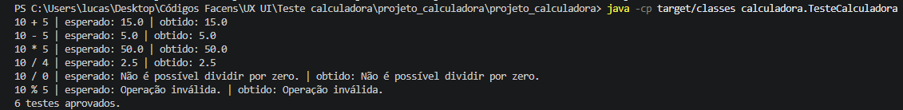

**Código original**

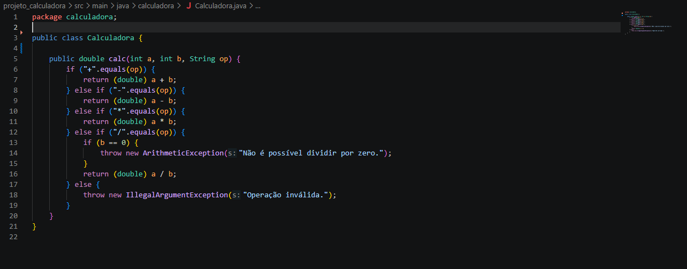

**Testes funcionais consolidados**

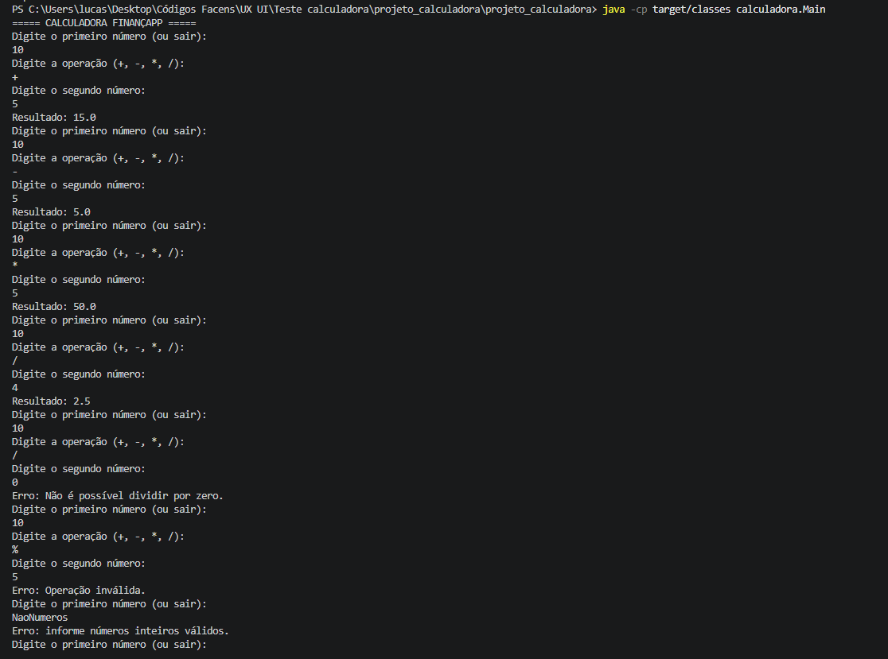

## Refatoração

A versão inicial utiliza condicionais `if/else`. Na branch `Refatoracao`, a seleção das operações foi reorganizada com `switch`, a divisão foi extraída para o método `dividir()` e os parâmetros desse método receberam nomes mais descritivos. A validação de operador nulo preserva o tratamento de operações inválidas.

Os testes foram repetidos para verificar a preservação do comportamento nos cenários avaliados.

**Branch Refatoracao**

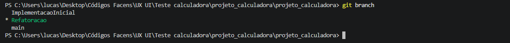

**Código refatorado**

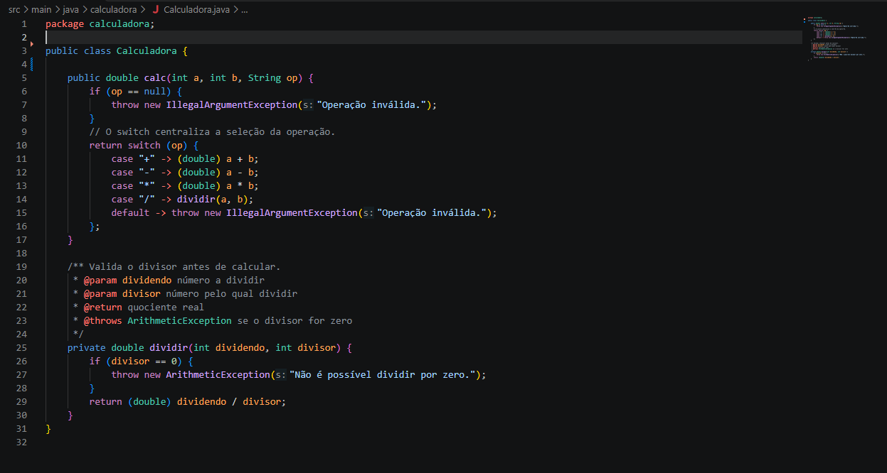

**Testes unitários após a refatoração**

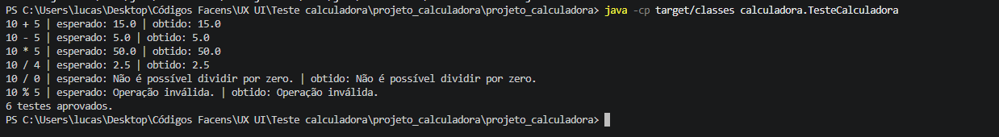

**Testes funcionais consolidados**

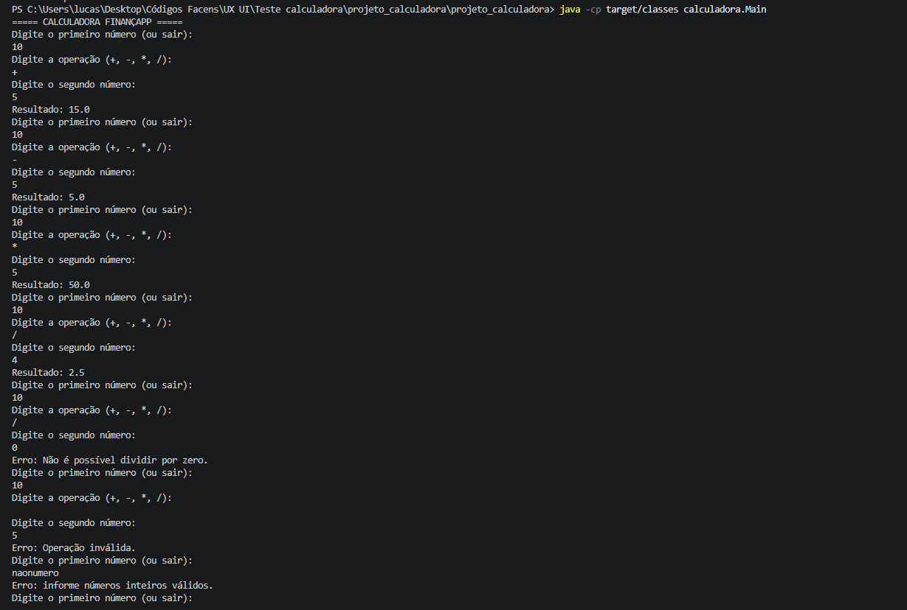

**Comparação das versões**

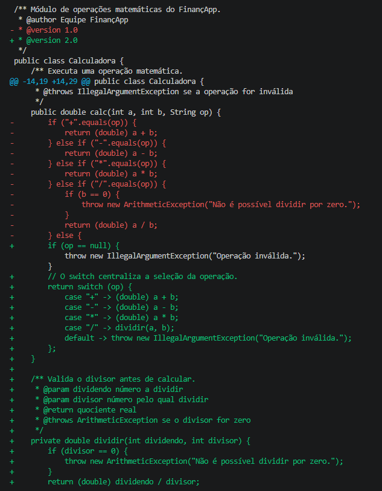

Registros textuais adicionais: [antes](evidencias/antes.txt) e [depois](evidencias/depois.txt).

## Documentação JavaDoc

A documentação descreve as classes, construtores, métodos, parâmetros, retornos e exceções. A geração final foi concluída sem erros ou avisos, com código de saída 0.

Para gerar novamente:

```powershell
javadoc -encoding UTF-8 -docencoding UTF-8 -charset UTF-8 -private -author -version -d docs -sourcepath src/main/java -subpackages calculadora
```

Para abrir localmente:

```powershell
Invoke-Item docs/index.html
```

[Arquivo inicial da documentação](docs/index.html) (para navegar pelo HTML, abra localmente após baixar o projeto).

**Geração da documentação**

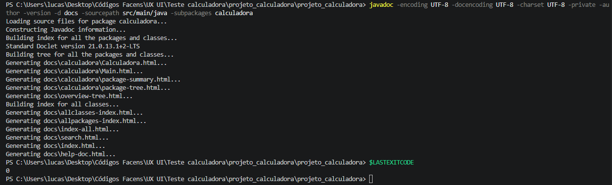

**Página inicial**

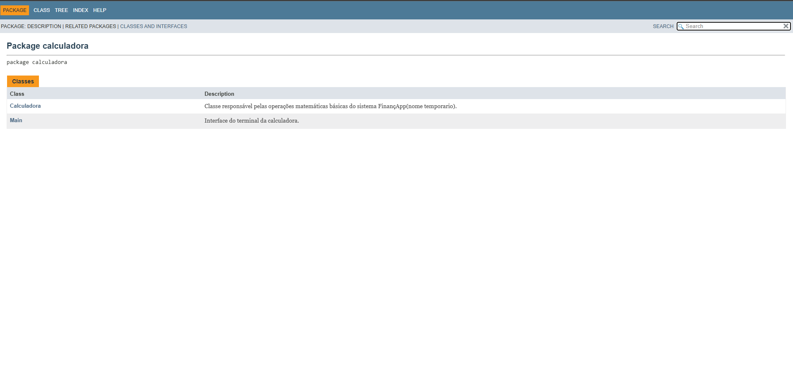

**Classe Calculadora**

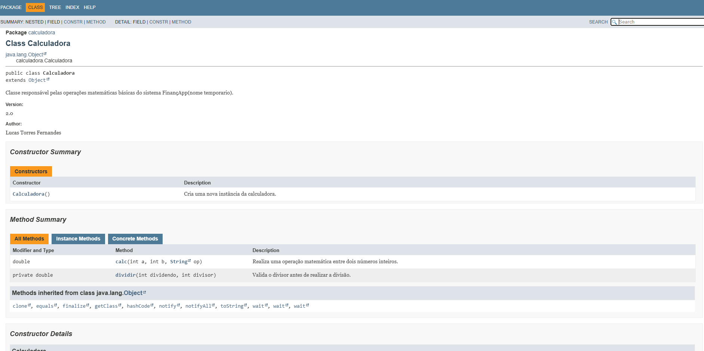

**Método calc**

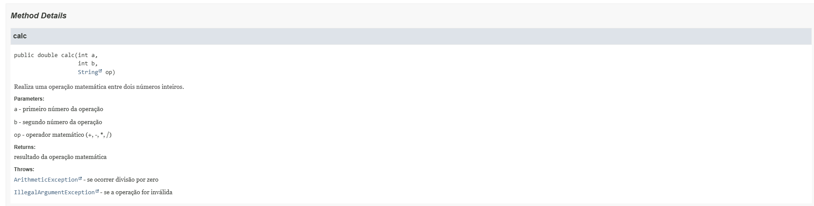

**Classe Main**

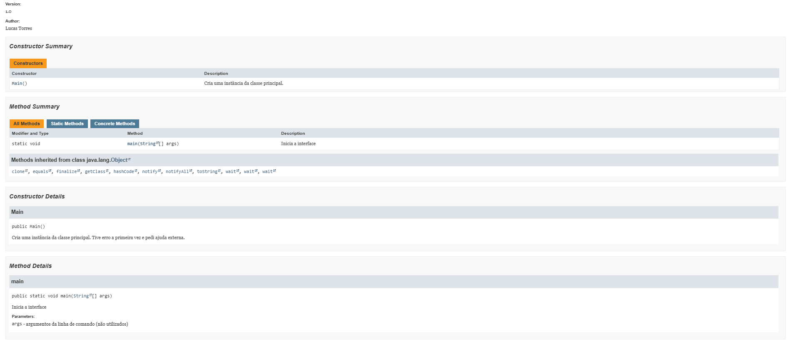

**Método dividir**

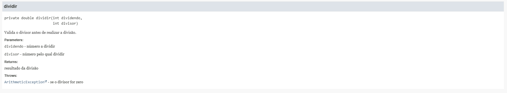

## Versionamento

- `main`: versão integrada e documentação final.
- `Refatoracao`: versão com as melhorias de organização do código.
- `ImplementacaoInicial`: versão original preservada para comparação.

**Branches**

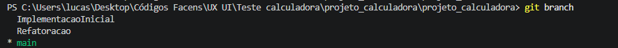

**Histórico de commits**

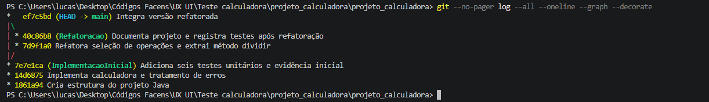

## Conclusão

O projeto demonstra a aplicação de práticas de qualidade de software em um módulo de cálculos básicos. Os testes permitem comparar as implementações, enquanto a refatoração melhora a organização do código e o JavaDoc facilita sua compreensão e manutenção.

## Repositório GitHub

https://github.com/SEU_USUARIO/projeto_calculadora
